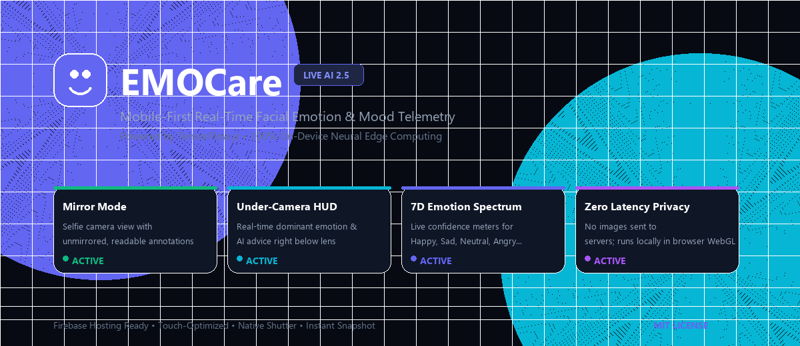
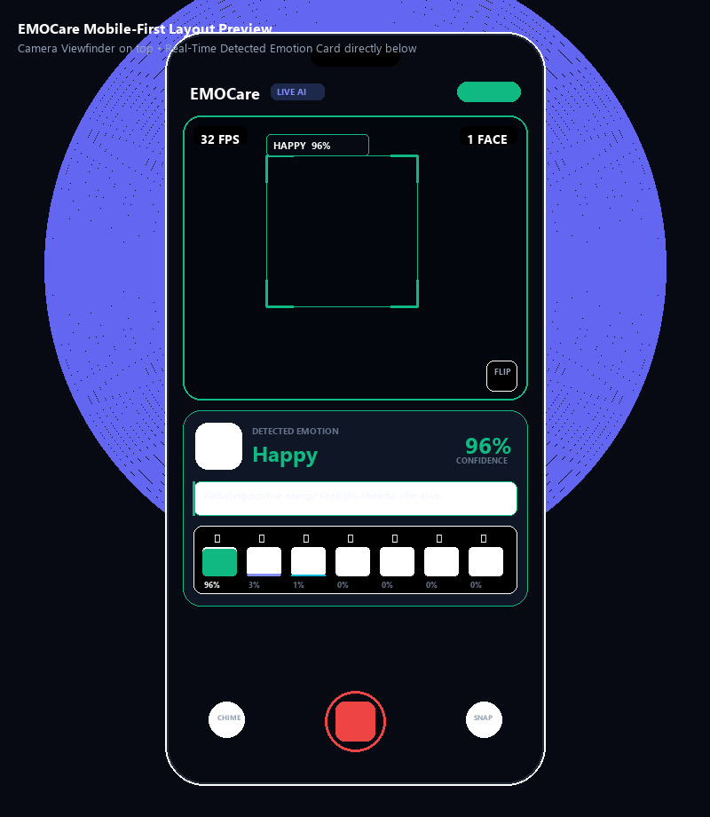
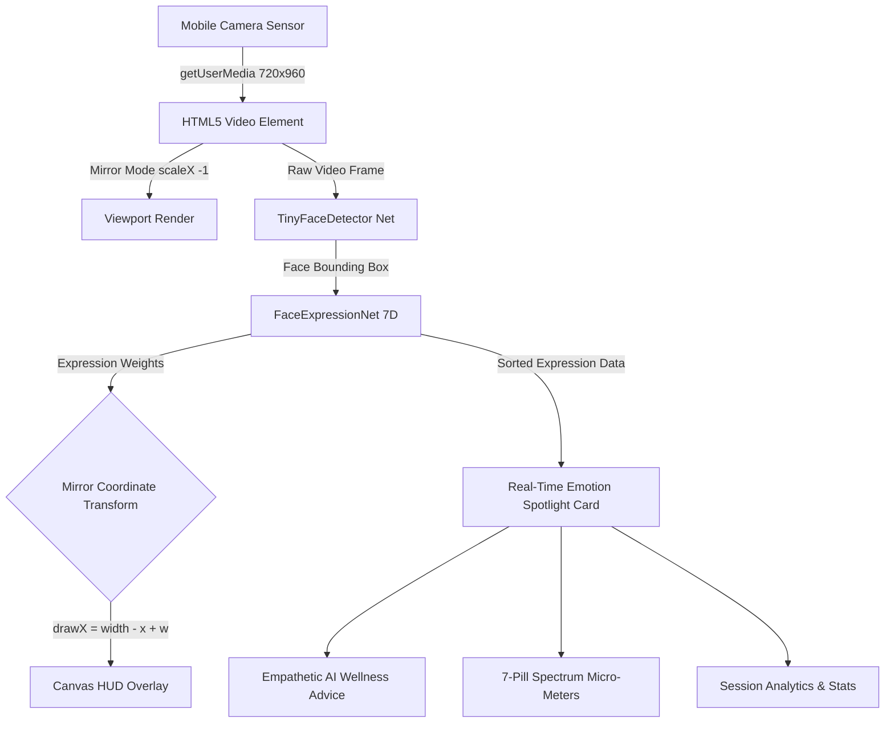

<p align="center">
  
</p>

<h1 align="center">EMOCare — Mobile AI Facial Emotion Telemetry</h1>

<p align="center">
  <strong>Next-Generation, On-Device Real-Time Emotion & Mood Telemetry Application</strong><br>
  Built with TensorFlow.js, WebGL Acceleration, and a Mobile-First Native Camera Experience.
</p>

<p align="center">
  
  
  
  
  
  
</p>

<p align="center">
  <a href="https://emocare-web.web.app" target="_blank">
    
  </a>
</p>

<p align="center">
  🌐 <strong>Live URL:</strong> <a href="https://emocare-web.web.app" target="_blank"><strong>https://emocare-web.web.app</strong></a>
</p>

---

## 📱 Mobile-First UI Architecture

EMOCare is engineered specifically for smartphone viewports (`100dvh`). When the camera is engaged, the user gets **instant real-time emotion telemetry directly beneath the lens**, eliminating the need for vertical scrolling.

<p align="center">
  
</p>

---

## 🌟 Key Features

| Feature | Description |
| :--- | :--- |
| 🪞 **Selfie Mirror Mode** | Flips the camera feed horizontally like a physical mirror. Bounding boxes and labels are mathematically inverted so text remains crisp and readable. |
| 🎯 **Under-Camera HUD** | Positioned directly below the camera card: shows big expressive emoji, emotion name, confidence percentage, and dynamic glow. |
| 💡 **Empathetic AI Guidance** | Context-aware micro-advice tailored to the detected emotion (e.g. 4-7-8 breathing for stress, uplifting affirmations for happiness). |
| 📊 **7D Emotion Spectrum** | Live animated micro-meters tracking `Happy`, `Neutral`, `Surprised`, `Sad`, `Fearful`, `Disgusted`, and `Angry` simultaneously. |
| 📸 **Telemetry Snapshot** | One-tap capture that burns an official EMOCare telemetry watermark onto the image and downloads it as a high-res PNG. |
| 🔄 **Dual Camera Flip** | Seamlessly switch between Front (Selfie) and Rear (Environment) cameras on mobile devices. |
| 🔔 **Adaptive Chimes** | Plays an audio chime when a face is recognized, with Web Audio API synthesizer fallback and one-tap mute. |
| 📋 **Bottom Sheet Drawer** | Slide-up drawer displaying session duration, total face scans, peak emotion tally, and preferences. |

---

## 🧠 Neural Pipeline & Architecture



### 🔒 100% Privacy Guarantee
- All neural inference executes **strictly on-device** via browser WebGL shaders.
- No webcam feeds, pictures, or facial vectors are transmitted over the network or saved to external servers.

---

## 🚀 Quick Start & Local Preview

Clone the repository and run any static file server:

### Option 1: Python
```bash
python -m http.server 8080 --directory public
```
Then navigate to: `http://localhost:8080`

### Option 2: Node.js (npx)
```bash
npx serve public
```

### Option 3: Firebase CLI
```bash
firebase emulators:start --only hosting
```

---

## 🌐 Deploy to Firebase Hosting

### 🔗 Live Production URLs
- **Primary Live URL**: [https://emocare-web.web.app](https://emocare-web.web.app)
- **Firebase App Domain**: [https://emocare-web.firebaseapp.com](https://emocare-web.firebaseapp.com)

Deploying EMOCare to Firebase Hosting takes seconds:

```bash
# 1. Install Firebase CLI globally (if not already installed)
npm install -g firebase-tools

# 2. Login to your Google Firebase account
firebase login

# 3. Deploy to production
firebase deploy --only hosting
```

Your web app will be live with free global CDN and automatic SSL!

---

## 📂 Project Directory Structure

```text
EmoCare_web/
├── public/
│   ├── index.html           # Main Mobile-First Application Shell & Script
│   ├── favicon.ico          # Multi-resolution Favicon (16x16, 32x32, 48x48, 64x64)
│   ├── favicon.svg          # Crisp Vector Scalable Favicon
│   ├── icon-192.png         # PWA / Mobile Home Screen Icon (192x192)
│   ├── icon-512.png         # High-Res Master App Icon (512x512)
│   ├── face_detected.mp3    # Audio alert asset
│   ├── 404.html             # Styled 404 error page
│   ├── firebase.js          # Firebase configuration & analytics setup
│   └── assets/              # Web-hosted preview graphics
│       ├── banner.png       # README Hero Banner
│       └── mobile-preview.png # Mobile Phone Mockup Illustration
├── assets/                  # Repository graphic assets
│   ├── banner.png
│   └── mobile-preview.png
├── firebase.json            # Firebase Hosting configuration
├── .firebaserc              # Firebase project link
└── README.md                # Project documentation with graphics
```

---

## 🎨 Supported Emotion Dimensions

| Emotion | Accent Color | Visual Representation | Key Wellness Advice |
| :--- | :--- | :---: | :--- |
| **Happy** | `#10b981` (Emerald) | 😊 | Radiating positive energy! Keep this cheerful vibe alive. |
| **Neutral** | `#818cf8` (Indigo) | 😐 | Calm, centered, and balanced. Optimal focus zone. |
| **Surprised** | `#06b6d4` (Cyan) | 😲 | Curiosity or awe detected! A spark for fresh learning. |
| **Sad** | `#3b82f6` (Blue) | 😔 | Take a deep, gentle breath. Better moments are ahead. |
| **Fearful** | `#a855f7` (Purple) | 😨 | Feeling uneasy? Ground yourself: name 3 comforting things. |
| **Disgusted** | `#f59e0b` (Amber) | 🤢 | Aversive reaction noticed. A breath of fresh air helps. |
| **Angry** | `#f43f5e` (Rose) | 😡 | Tension noticed. Try slow 4-7-8 rhythmic breathing. |

---

## 📄 License

This project is licensed under the [MIT License](LICENSE) — free for personal, educational, and commercial usage.
